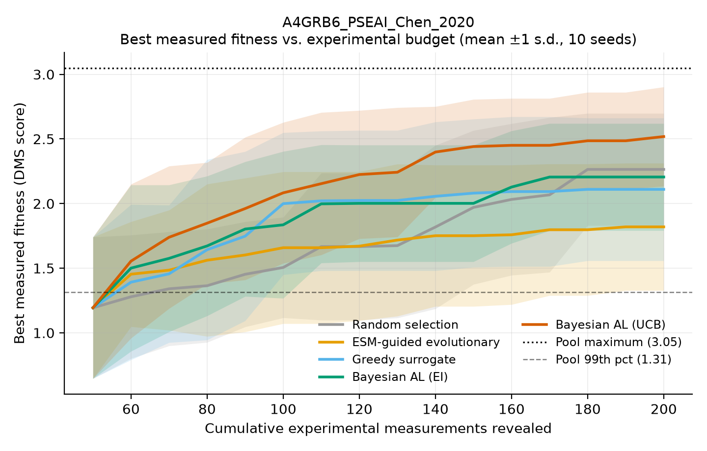
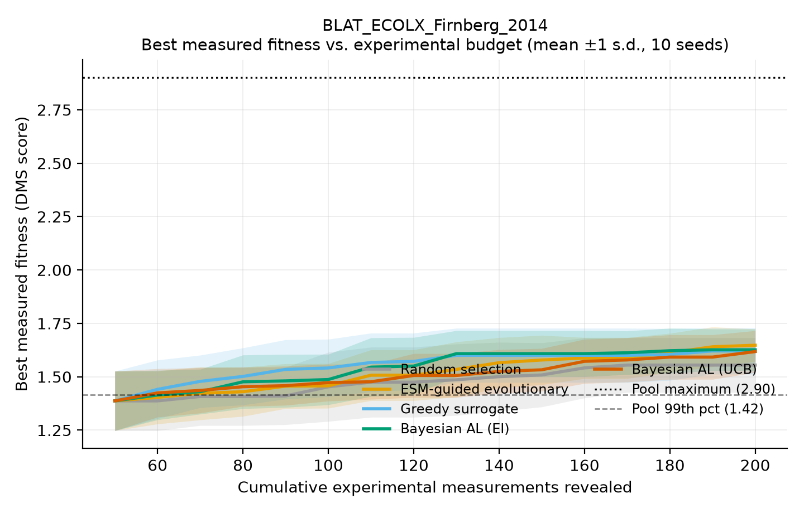
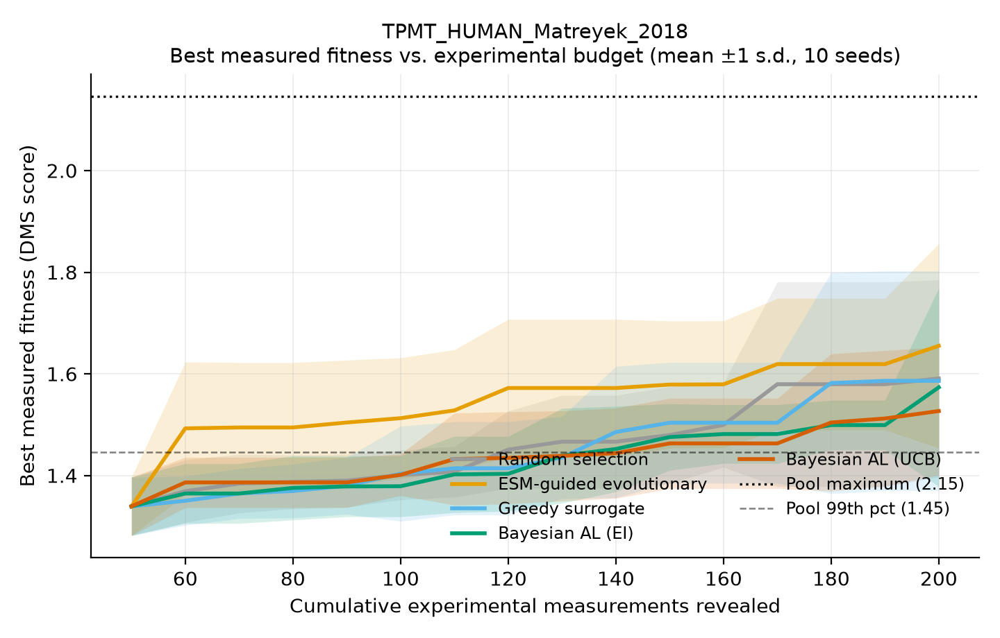
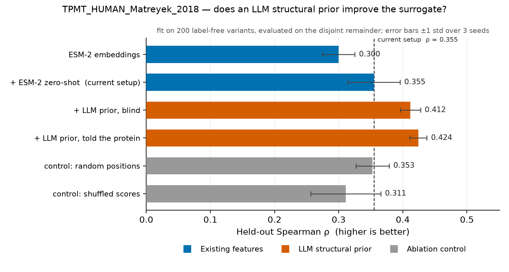
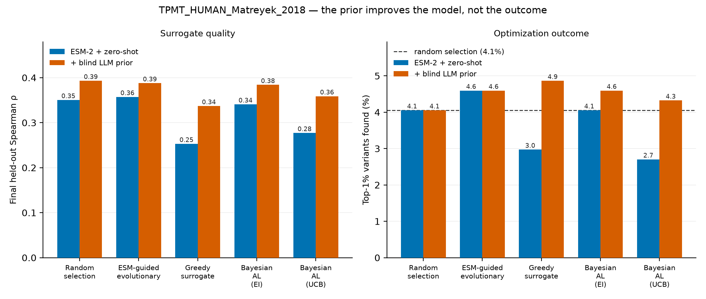

# Drucion

**Closed-loop, uncertainty-aware active learning for protein engineering.**

Drucion learns which protein variant to measure next. It embeds variants with
ESM-2, fits a Gaussian-process surrogate on the measurements it has already
paid for, estimates its own uncertainty, picks the most informative batch of
untested variants, reveals their real measured fitness, retrains, and repeats.

Every fitness value it ever sees is a **real, previously published
deep-mutational-scanning measurement** from
[ProteinGym](https://github.com/OATML-Markslab/ProteinGym). This is a
retrospective simulation of experimental selection — no wet-lab experiment is
performed here, and no fitness value is ever invented.

---

## Headline result

**Scope first:** this is the result on one assay of three. It is the strongest
one, and the other two are reported immediately below, including where the
method loses.

On **VIM-2 β-lactamase** (`A4GRB6_PSEAI_Chen_2020`, 5,004 measured single
variants, carbapenem resistance), with 50 initial measurements, batches of 10
and 15 rounds (200 measurements total, 4% of the pool), averaged over 10 seeds:

| Method | Best measured | Normalised AUC | Top-1% variants found | Measurements to reach 99th pct |
|---|---|---|---|---|
| Random selection | 2.264 ± 0.434 | 0.737 ± 0.086 | 4.7% | 92 |
| ESM-guided evolutionary | 1.820 ± 0.493 | 0.722 ± 0.103 | 8.2% | 89 (80% of seeds) |
| Greedy surrogate | 2.110 ± 0.552 | 0.769 ± 0.101 | 9.2% | 74 (90% of seeds) |
| Bayesian AL (EI) | 2.206 ± 0.414 | 0.774 ± 0.084 | 10.0% | 78 |
| **Bayesian AL (UCB)** | **2.519 ± 0.384** | **0.821 ± 0.075** | **15.5%** | **68** |

Because every method starts each seed from *identical* initial measurements,
seeds are paired and a paired test is the right one. UCB vs. random, paired
Wilcoxon over 10 seeds:

| Metric | Seeds won | Mean difference | p |
|---|---|---|---|
| Top-1% variants found | **10 / 10** | **+10.8 points** (3.3× enrichment) | **0.002** |
| Normalised AUC | 7 / 10 | +0.084 | **0.027** |
| Measurements to 99th pct | 6 / 10 (4 tied) | **−24 measurements** | **0.031** |
| Best measured fitness | 7 / 10 | +0.254 | 0.32 (not significant) |

**Experimental efficiency:** random selection spends all 200 measurements to
reach a best fitness of 2.264. UCB reaches that same level after **140
measurements — 30% fewer experiments.**

Two honest caveats sit in that table. The *single best value found* is a max
statistic with large variance and its difference is **not** statistically
significant at 10 seeds. And this is VIM-2 — the assay where the surrogate
learns best. The claims that hold up here are about enrichment and efficiency:
finding many more top variants, sooner. For protein engineering that is the
more useful quantity anyway — you want a shortlist of good leads, not one lucky
hit.



### Exploration keeps the model honest

A second result falls out of the same runs. Measuring each method's surrogate
against the held-out set at the end of the budget:

| Method | Final held-out ρ | Normalised AUC |
|---|---|---|
| Random selection | 0.561 | 0.737 |
| **Bayesian AL (UCB)** | 0.546 | **0.821** |
| Bayesian AL (EI) | 0.521 | 0.774 |
| ESM-guided evolutionary | 0.518 | 0.722 |
| Greedy surrogate | **0.464** | 0.769 |

Uniformly random measurement is the best way to train a general-purpose model —
its training set is unbiased — so random sets the ceiling at ρ = 0.561. Greedy
exploitation sits at the other extreme: it only ever measures what the model
already likes, so its training set becomes progressively less informative and
its model decays to 0.464.

UCB gives up almost nothing against the random ceiling (0.546 vs 0.561) while
delivering by far the best optimization outcome. That is the uncertainty term
paying for itself — it buys optimization performance at close to zero cost in
model quality, which is exactly what greedy cannot do.
### Across three assays: the benefit tracks surrogate quality

Running the identical pipeline on three assays gives the most useful result in
the project — and it is not "our method always wins".

| Assay | Surrogate ρ (held out) | Random, top-1% found | Best guided method | Enrichment |
|---|---|---|---|---|
| VIM-2 β-lactamase | **0.561** | 4.7% | **UCB — 15.5%** | **3.3×** |
| TEM-1 β-lactamase | 0.476 | 4.0% | evolutionary — 10.8% | 2.7× |
| TPMT | 0.350 | 4.1% | evolutionary — 4.6% | 1.1× |

**Model-guided selection beats random exactly to the extent that the surrogate
can rank unseen variants**, and the relationship is monotone across all three
assays.

| TEM-1 β-lactamase | TPMT |
|---|---|
|  |  | Where the model is informative you get a 3× enrichment of top variants;
where it is not (TPMT, ρ = 0.35) the loop degenerates into an expensive random
search and buys nothing measurable.

### Two results that do not flatter the method

**UCB is not universally the best selector.** It dominates on VIM-2
(p = 0.002). On TEM-1 it still beats random on top-1% recall (8.5% vs 4.0%,
paired p = 0.031) but is *behind* both greedy (10.0%) and the ESM-guided
evolutionary baseline (10.8%). On TPMT nothing beats random significantly. With
10 seeds we cannot crown a universal winner, and we do not.

**The non-learning baseline is strong.** The ESM-guided evolutionary search
trains no model at all, yet it is the best method on two of the three assays
and matched random's final result with 30% fewer measurements on TEM-1 and 15%
fewer on TPMT. The trainable surrogate's advantage over a well-built zero-shot
ESM baseline is established **only on VIM-2**, not in general. Anyone reading
this as "learned surrogates beat ESM heuristics" would be over-reading our
evidence.

On TPMT specifically, none of UCB's differences against random reach
significance in either direction (best measured p = 0.73, AUC p = 0.16, top-1%
p = 0.13). The accurate statement is "buys nothing measurable here", not "is
worse here". The same TPMT runs do show greedy degrading its own model hardest
(final ρ 0.253 vs random's 0.350) while UCB holds 0.277 — the uncertainty term
pulling it back toward exploration when the model is uninformative, which is
the behaviour it exists to provide.

### An LLM structural prior improves the model but not the outcome

A fourth, label-free feature was added: an LLM is shown the wild-type sequence
and the kind of assay, and asked which residue positions are functionally
critical and which substitution classes are tolerated. Its answer is converted
to one scalar per variant by local arithmetic and appended as a feature column,
exactly as the ESM-2 zero-shot score already is. One model call per assay, not
per variant. The prompt withholds the protein's identity by default, so the
model reasons from sequence and assay type rather than recalling a published
result.

On TPMT the prior clearly improves the **representation**:

| Representation | Held-out ρ |
|---|---|
| `esm2` | 0.300 ± 0.025 |
| `esm2 + zero_shot` (the configuration the benchmark uses) | 0.355 ± 0.041 |
| **`+ LLM prior, blind`** | **0.412 ± 0.016** |
| `+ LLM prior, told the protein` | 0.424 ± 0.013 |
| control: shuffled prior scores | 0.311 ± 0.055 |
| control: random critical positions | 0.353 ± 0.026 |



The two controls are what make that readable. Permuting the prior's scores
across variants — same distribution, no per-variant information — lands *below*
baseline, so the gain is not an artefact of adding a column. Reassigning the
same number of critical positions at random also lands at baseline, so it is
not "any sparse positional prior helps". And the blind prior recovers 94% of
the named prior's gain, which is the control that matters most here: ProteinGym
assays are published, and a prior that worked only when told the protein's name
would be recall rather than reasoning.

**It does not convert into better optimization.** Running the full benchmark
with the blind prior enabled (10 seeds, identical budget):

| Method | Top-1% found, baseline | with prior | Final ρ, baseline | with prior |
|---|---|---|---|---|
| Random selection | 4.1% | 4.1% | 0.350 | 0.393 |
| ESM-guided evolutionary | 4.6% | 4.6% | 0.357 | 0.388 |
| Greedy surrogate | 3.0% | 4.9% | 0.253 | 0.337 |
| Bayesian AL (EI) | 4.1% | 4.6% | 0.341 | 0.384 |
| Bayesian AL (UCB) | 2.7% | 4.3% | 0.277 | 0.359 |



Every method's surrogate improves, and no method ends up meaningfully ahead of
random's 4.1%. Normalised AUC is flat (0.505 random vs 0.492 UCB). The
enrichment on TPMT stays at roughly 1.1×.

Two things follow, and the second is the more important one.

**The prior is a floor, not a lift.** Greedy and UCB had been *below* random
(3.0% and 2.7%) because exploitative selection degrades its own training set.
With the prior they recover to approximately random. That is a real effect —
the prior supplies information the biased training set cannot — but "stops the
model collapsing" is a weaker claim than "finds more top variants", and only
the first is supported.

**It is evidence against reading the surrogate-quality relationship as a
lever.** The monotone ρ-to-enrichment relationship above was measured *across*
assays, over a ρ span of 0.350–0.561. Extrapolating it predicted that lifting
TPMT's ρ to ~0.41 would raise enrichment toward 2.5×. That prediction was made
in advance and **it failed**. Raising ρ within an assay did not move enrichment
there. Either ρ ≈ 0.39 is still below whatever threshold makes guided selection
pay on this assay, or whole-pool rank correlation is simply the wrong statistic
to predict top-tail enrichment — a prior that mostly identifies which variants
are *bad* need not sharpen discrimination among the good ones. These runs
cannot separate those two explanations, and only TPMT was tested.

Enabling it requires a Gemini API key in `.env` (see `.env.example`); it is off
by default and nothing above it changes when it is off:

```bash
python scripts/representation_check.py --assay TPMT_HUMAN_Matreyek_2018 \
    --featurizers esm2 --agent-prior --save
python scripts/run_benchmark.py --assay TPMT_HUMAN_Matreyek_2018 \
    --seeds 10 --agent-prior --tag agentprior
```

## Quickstart

Requires Python 3.11+ and Node 18+. CPU-only works; CUDA and Apple MPS are used
automatically when present.

```bash
git clone https://github.com/axhero7/drucion.git && cd drucion
python3.11 -m venv .venv
.venv/bin/pip install -e ".[dev]"
.venv/bin/python scripts/download_data.py
```

`download_data.py` fetches ProteinGym v1.3 (43 MB compressed, ~1 GB expanded,
217 assays) plus the AlphaFold2 wild-type structures used by the 3D explorer
(19 MB; pass `--skip-structures` to omit them).

Build the dashboard and start the server:

```bash
cd frontend && npm install && npm run build && cd ..
.venv/bin/python -m uvicorn drucion.api.app:app --port 8000
```

Open <http://localhost:8000>.

For frontend development with hot reload, keep the API running on port 8000 and
run `npm run dev` in `frontend/`. Vite serves the UI on
<http://localhost:5173> and calls the API directly at `localhost:8000`; that
origin is already allow-listed in the API's CORS configuration.

### Reproduce the benchmark

```bash
.venv/bin/python scripts/precompute_embeddings.py A4GRB6_PSEAI_Chen_2020
.venv/bin/python scripts/run_benchmark.py --assay A4GRB6_PSEAI_Chen_2020 --seeds 10
```

Takes about 11 minutes on an M2 laptop (CPU/MPS) and writes CSV, JSON and
publication-quality plots to `results/`.

Every number quoted in this README can be regenerated from those artifacts:

```bash
.venv/bin/python scripts/report.py --assay A4GRB6_PSEAI_Chen_2020
```

### Tests

```bash
.venv/bin/python -m pytest
```

258 tests, ~4 min. Tests marked `real_data` skip automatically if ProteinGym has
not been downloaded.

---

## How it works

```
ProteinGym assay ──► CandidatePool  (mutations + sequences, NO labels)
                 └─► ExperimentalOracle  (real DMS scores, sealed behind a budget)

              ┌──────────────────────────────────────────────┐
              │  1. fit surrogate on revealed measurements   │
              │  2. predict mean + uncertainty for the pool  │
              │  3. score candidates with an acquisition fn  │
              │  4. select a diverse batch of untested ones  │
              │  5. query the oracle (spends budget)         │
              │  6. add measurements, retrain, repeat        │
              └──────────────────────────────────────────────┘
```

**Representations** (`backend/drucion/embeddings/`). Mean-pooling a 266-residue
protein barely moves when one residue changes, so the default featurizer is
*site-resolved*: for each variant it takes ESM-2's final hidden state at the
mutated residue and concatenates it with the difference from the wild-type
hidden state at that same position, `[h_mut(site), h_mut(site) − h_wt(site)]`.
That is PCA-reduced to 24 components, and the ESM-2 masked-marginal zero-shot
score is appended as one more label-free feature.

Held-out Spearman ρ on TPMT, surrogate fit on 200 random variants and tested on
the disjoint remainder (`scripts/representation_check.py --save`, saved to
`results/representation_check.json`):

| Representation | without zero-shot | with zero-shot |
|---|---|---|
| **ESM-2 site-resolved** (default) | 0.300 | **0.355** |
| ESM-2 mean-pooled | 0.261 | 0.318 |
| Mutation one-hot (control) | **−0.003** | 0.121 |

Two things to read off that table. Site-resolved features beat mean pooling,
and the zero-shot score adds a further ~0.05 on top of either. And the one-hot
control — which carries no pretrained knowledge at all — sits at ρ ≈ 0.00,
which is how we know the signal comes from ESM-2 rather than from the pipeline
or from some artefact of the evaluation.

**Surrogate** (`backend/drucion/models/surrogate.py`). BoTorch `SingleTaskGP` in
double precision with input normalisation and outcome standardisation, giving
a posterior mean and standard deviation. A random-forest ensemble (per-tree
spread as uncertainty) is available as a documented fallback and is selected
automatically if GP fitting raises; the active surrogate is always reported, so
a run never silently claims to be a GP when it is not. Honest note: the RF
ensemble is slightly *more* accurate on point predictions (ρ 0.41 vs 0.36 on
TPMT at n=200), but the GP's calibrated uncertainty is what UCB and EI need.

**Acquisition** (`backend/drucion/optimization/acquisition.py`). UCB
(`μ + βσ`), analytic Expected Improvement, greedy exploitation, and random, all
scored over the *finite* pool of measured candidates — ProteinGym can only
reveal fitness for variants that were actually assayed, so this is ranking, not
continuous optimisation in embedding space. Batch selection is a diversity-
filtered top-k: a candidate within a small feature distance of an already-chosen
pick is skipped for the next best, which stops one promising cluster from
consuming a whole batch. The diversity filter is deliberately **not** applied
to the random baseline — random screening has no notion of diversity, and
filtering it would mean comparing against a smarter-than-random baseline.
`tests/test_loop.py::TestRandomBaselineIsUniform` pins that.

**Evolutionary baseline** (`backend/drucion/optimization/evolutionary.py`).
ESM-2 ranks candidates by zero-shot plausibility, and elite variants from
previous rounds focus the search onto the positions they mutate. It uses
experimental feedback only to choose *where* to look, with no surrogate — which
is what makes it the right control for "is the trainable model doing anything?"

---

## Scientific integrity

The benchmark is only meaningful if the hidden labels stay hidden. That is
enforced in code and pinned by tests (`tests/test_no_leakage.py`, 19 tests):

- `CandidatePool` is a frozen dataclass with exactly four fields — assay id,
  wild type, mutation specs, sequences. It has no attribute that holds fitness.
- `ExperimentalOracle` keeps the scores private. `query()` is the only path
  from a candidate index to a number, and it charges the budget.
- A static test asserts that the acquisition, surrogate and featurizer modules
  never reference any label-reading API by name.
- Surrogate accuracy is measured on a fixed 500-variant holdout that is removed
  from the candidate pool entirely: never trained on, never selectable, never
  charged to budget. Reading it goes through `peek_for_evaluation`, which is
  called once, after selection is committed, and is pinned to that single call
  site by a test.
- Budget accounting is read back from the oracle's own counter, not tracked
  separately, and every method is asserted to consume exactly
  `n_initial + batch_size × n_rounds` measurements.

**Fairness.** For each seed, every method gets the same candidate pool, the same
precomputed features, the same initial measurements, the same budget, and a
fresh oracle so counters never bleed between runs. Only the selection rule
differs.

**PCA caveat.** PCA is fit on the features of the whole candidate pool. That is
unsupervised and label-free, so it leaks no fitness information, and it is
applied identically to every method. It is nonetheless transductive, and is
documented here rather than buried.

**Representation choice.** The site-resolved featurizer and the zero-shot
feature were selected once, on TPMT, using `scripts/representation_check.py`,
and then applied unchanged to the other assays. VIM-2 — the headline result —
is therefore a clean held-out application of that choice.

**Generated variants.** The evolutionary engine can propose novel substitutions
that were never assayed. Those are counted and surfaced in the UI as
*unvalidated*, and are never assigned an invented score or included in any
ground-truth comparison.

---

## Dashboard

Four views, all driven by the live API:

- **Setup** — pick any of the 217 ProteinGym assays, see its provenance,
  publication, wild-type sequence, full validation report (how many rows were
  dropped and why), and achievable fitness range; configure method, budget,
  batch size, representation, surrogate and seed.
- **Live optimization** — step one round at a time or run to completion, with
  Server-Sent Events streaming progress. Shows each selected variant's
  acquisition score, predicted fitness, predicted uncertainty and then the
  revealed measurement side by side, plus the surrogate's held-out accuracy
  climbing as measurements accumulate.
- **Benchmark** — best measured fitness vs. cumulative evaluations with ±1 s.d.
  bands, the efficiency comparison, the full metrics table, the seed-paired
  significance table, and the surrogate-accuracy curves. Reads saved results
  instantly or launches a new benchmark.
- **Protein explorer** — a 3D view of the wild-type fold with every probed
  residue marked and coloured by its real measured fitness, scrubbable and
  replayable round by round so you watch the search sweep across the protein;
  plus wild type vs. best discovered sequence with
  substitutions highlighted, predicted-vs-measured scatter coloured by round,
  and which residue positions the search concentrated on.

Model predictions (purple) and real measurements (green) are visually distinct
everywhere they appear.

---

## Repository layout

```
backend/drucion/
  config.py              # dataclass configuration, device resolution
  data/proteingym.py     # loader, validator, CandidatePool, ExperimentalOracle
  embeddings/
    esm.py               # ESM-2 embeddings (mean + site-resolved), zero-shot scores, caching
    features.py          # featurizers, PCA reduction
  models/surrogate.py    # GP (BoTorch) + RF ensemble fallback
  optimization/
    acquisition.py       # UCB, EI, greedy, batch selection with diversity
    evolutionary.py      # ESM-guided evolutionary baseline
    loop.py              # ClosedLoopOptimizer — the closed loop
  evaluation/
    metrics.py           # AUC, regret, recall, paired tests, efficiency
    plots.py             # publication-quality figures
  experiments/
    benchmark.py         # controlled multi-method, multi-seed comparison
    store.py             # SQLite persistence
  api/                   # FastAPI app, Pydantic schemas, session manager, SSE
frontend/src/            # React + TypeScript + Plotly dashboard
scripts/                 # download_data, precompute_embeddings, run_benchmark,
                         #   representation_check, report
tests/                   # 258 tests
results/                 # benchmark CSV/JSON/PNG (committed)
```

## API

| Endpoint | Purpose |
|---|---|
| `GET /api/assays` | All locally available ProteinGym assays |
| `GET /api/assays/{id}?full=true` | Metadata, provenance, validation report, pool stats |
| `GET /api/assays/{id}/structure` | Wild-type PDB for the 3D view, refused on residue-numbering mismatch |
| `POST /api/experiments` | Create an experiment (features computed in background) |
| `GET /api/experiments/{id}` | Current state |
| `POST /api/experiments/{id}/step` | Run exactly one round |
| `POST /api/experiments/{id}/run` | Run remaining rounds in a background thread |
| `POST /api/experiments/{id}/pause` | Stop after the current round |
| `POST /api/experiments/{id}/reset` | Fresh run, same configuration |
| `GET /api/experiments/{id}/stream` | Server-Sent Events |
| `GET /api/experiments/{id}/results` | Full results, sequence diff, round history |
| `POST /api/benchmarks` | Launch a multi-method, multi-seed benchmark |
| `GET /api/benchmarks/{id}` | Benchmark progress and results |
| `GET /api/results/precomputed` | Saved benchmark JSON from `results/` |

Interactive docs at `/docs`.

---

## Provenance, licensing and attribution

**ProteinGym** (Notin et al., NeurIPS 2023 Datasets & Benchmarks) — MIT licence,
<https://github.com/OATML-Markslab/ProteinGym>. Assay data downloaded from
`marks.hms.harvard.edu/proteingym/ProteinGym_v1.3/`. Each assay carries its own
underlying publication, shown in the dashboard; the primary assays here are
Chen et al. (VIM-2 β-lactamase, 2020), Matreyek et al. (TPMT, 2018) and Firnberg
et al. (TEM-1 β-lactamase, 2014).

**ESM-2** (Lin et al., *Science* 2023) — `facebook/esm2_t6_8M_UR50D`, MIT
licence. Larger checkpoints work by changing `EmbeddingConfig.model_name`.

**BoTorch / GPyTorch** (Balandat et al., NeurIPS 2020) — MIT licence.

**EvoEmu** (<https://github.com/ibrahimaasim77/EvoEmu>) — the inspiration for
this project's evolutionary search and the starting point for its framing.
EvoEmu publishes no licence file, so **no EvoEmu code is copied here**. Its
ESM-2 masked-substitution proposal logic and elite-consensus evolutionary search
were re-implemented independently in
`backend/drucion/embeddings/esm.py` and
`backend/drucion/optimization/evolutionary.py`, with attribution in the module
docstrings. Drucion's contribution relative to EvoEmu is the trainable
surrogate and the experimental feedback loop: EvoEmu performs inference-driven
search with no learning, whereas Drucion trains a model on revealed
measurements and uses its uncertainty to decide what to measure next.

BioEmu is deliberately **not** in the critical path — structure-based analysis
would be an optional extension, not a dependency.

---

## Limitations

- **Retrospective, not prospective.** Drucion selects from variants that were
  already assayed. It does not predict the fitness of genuinely novel sequences,
  and the candidate pool is therefore pre-filtered in ways a real campaign's
  would not be.
- **Single substitutions only** by default. Epistasis between mutations is not
  exercised, though multi-mutant assays load fine (`singles_only=False`).
- **The small ESM-2.** The 8M-parameter checkpoint was chosen so the whole
  demo runs on a laptop. Larger checkpoints would likely raise surrogate
  accuracy and, per the mechanism above, the size of the active-learning win.
- **Ten seeds.** Enough for the paired tests reported, not enough to call small
  differences in the max statistic.
- **Assay-dependent benefit.** Saved benchmarks cover three assays. The claim
  is not "active learning always wins" — it demonstrably does not on TPMT, and
  the non-learning evolutionary baseline is the best method on two of the
  three. Three points show the surrogate-quality relationship is monotone; they
  are not enough to fit it.
- **No universal winner.** UCB is best on VIM-2, the evolutionary baseline on
  TEM-1 and TPMT. At 10 seeds we do not claim a best method.
- **Structure is for orientation, not prediction.** The 3D view places real
  measurements on the published AlphaFold2 model of the *wild type*. There is
  no mutant structure in the dataset, a single substitution does not visibly
  move a backbone, and nothing here predicts structural consequence. The
  backbone deliberately never morphs as you scrub.
- **The LLM prior is tested on one assay.** Its +0.057 ρ on TPMT comes from a
  single prior draw at temperature 0 on a single assay, scored over 3 seeds.
  VIM-2 and TEM-1 have not been run. The benchmark result that follows from it
  is likewise TPMT-only, and TPMT is the assay where ESM-2 is weakest — the
  case with the most room for an outside prior to help, so the gain should be
  read as an upper bound rather than a typical value.

## What is not finished

- Structure-aware *features* (the surrogate still sees only sequence-derived
  ESM-2 features; spatial proximity of successful mutations is visible in the
  3D view but not fed back into the model).
- Larger ESM-2 checkpoints are configurable but have not been benchmarked.
- The benchmark runs methods sequentially; parallelising across seeds would cut
  wall time roughly fivefold.
- The LLM structural prior has not been replicated on VIM-2 or TEM-1, and the
  prior is used only as an extra feature column. The two stronger attachment
  points — as the GP's prior mean, or as per-position kernel lengthscales —
  are unimplemented. See `HANDOFF.md`.
